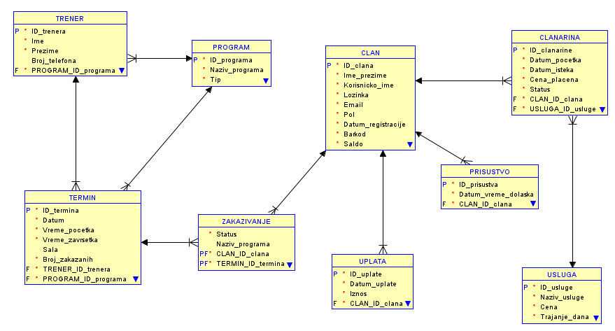
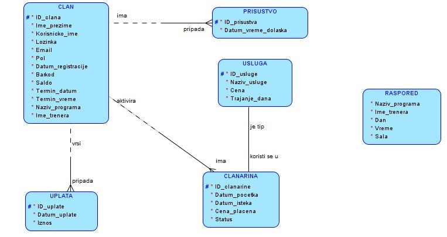
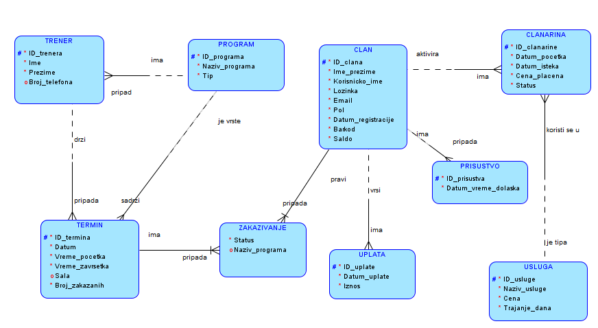
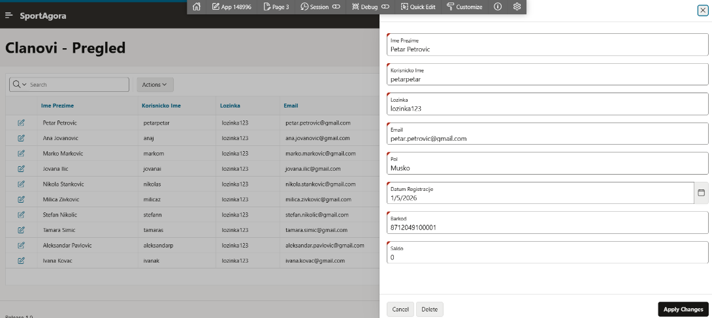
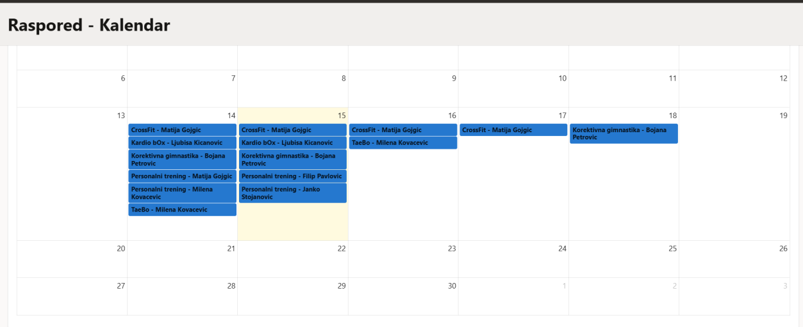
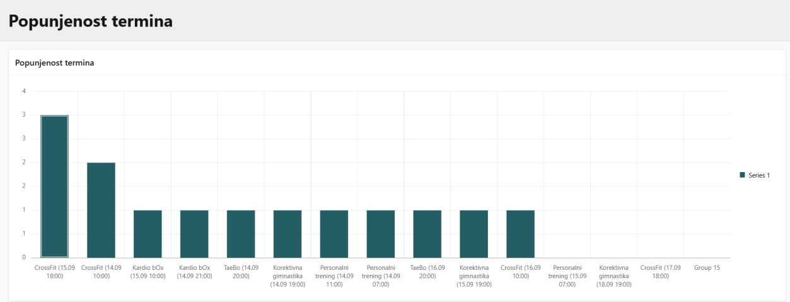
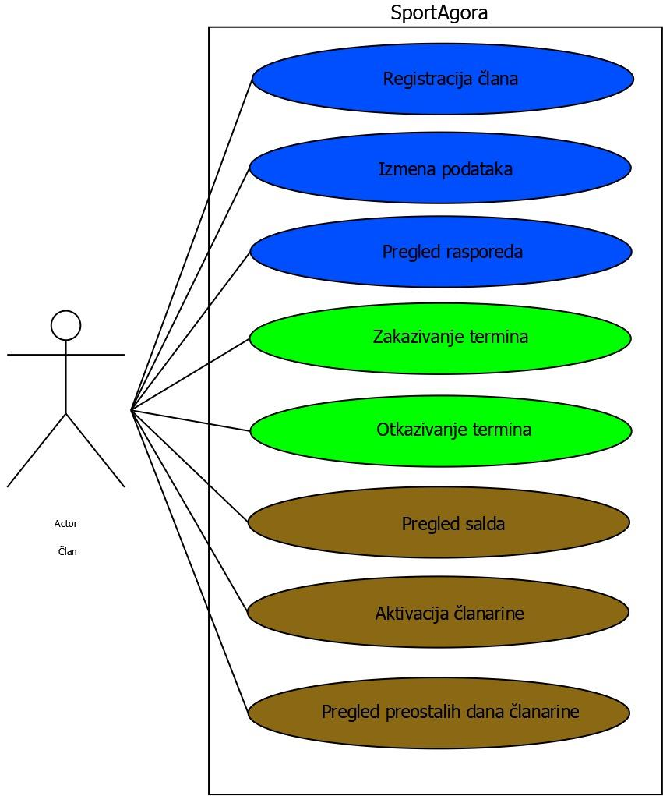

# SportAgora – Gym Management Database

Relational database and Oracle APEX web application for managing the day-to-day operations of **SportAgora**, a sports club / gym in Čačak, Serbia. The model is based on real data and documents collected directly from the club.

University project for the course *Praktikum iz baza podataka* (Database Practicum), Faculty of Technical Sciences Čačak, University of Kragujevac.

> 🇷🇸 Kratak opis na srpskom nalazi se [na dnu stranice](#-opis-na-srpskom).

## Tech stack

- **Oracle Database** – SQL, PL/SQL (triggers, procedures, functions)
- **Oracle APEX** – web application (13 pages, forms, reports, calendar, charts)
- **Data modeling** – logical model (MOV/ER), relational schema, UML use-case diagram

## What it does

The application covers the main processes of the gym:

- **Members** – registration, profile editing, auto-generated member ID and barcode (sequence + trigger)
- **Memberships** – activating a membership for a service, tracking expiry and remaining days
- **Payments & balance** – recording payments, keeping each member's balance up to date
- **Training schedule** – sessions by program, trainer and room, shown as a table and an interactive calendar
- **Bookings** – booking and cancelling sessions, with live occupancy per session

## Database design

The schema has **9 tables** in third normal form: `CLAN`, `CLANARINA`, `USLUGA`, `UPLATA`, `PRISUSTVO`, `PROGRAM`, `TRENER`, `TERMIN`, `ZAKAZIVANJE`.



### Normalization
The starting model (one wide member table plus a flat schedule) was taken step by step through 1NF, 2NF and 3NF by removing repeating groups, partial dependencies and transitive dependencies.

| Before normalization | After normalization |
|---|---|
|  |  |

### Denormalization (read performance)
1. **Copied attribute:** `ZAKAZIVANJE.Naziv_programa` stores the program name so a member's bookings can be listed without joining `ZAKAZIVANJE → TERMIN → PROGRAM`. It is kept in sync by triggers.
2. **Stored aggregate:** `TERMIN.Broj_zakazanih` stores the number of bookings per session instead of running `COUNT()` on every schedule view. It is maintained by insert/update/delete triggers.

### Optimization
- **Materialized balance:** `CLAN.Saldo` stores `SUM(payments) − SUM(memberships)` and is updated by triggers on `UPLATA` and `CLANARINA`. A `BEFORE INSERT` trigger also blocks activating a membership when the balance is too low.
- **Indexes** on the most frequent lookups, for example sessions by date, attendance by member and date, and memberships by status.

### PL/SQL
- `aktiviraj_clanarinu(p_id_clana, p_id_usluge)` – procedure that activates a membership, taking the current price from the price list and calculating the expiry date from the service duration.
- `preostalo_dana_clanarine(p_id_clana)` – function that returns the number of days left on a member's active membership.

## Application

| Members | Training calendar |
|---|---|
|  |  |



Use cases covered by the app:



## Repository structure

```
├── sql/
│   ├── 01_schema.sql                  # tables, primary keys, checks, indexes, sequences
│   ├── 02_constraints_and_plsql.sql   # foreign keys, triggers, procedure, function
│   └── apex_app_f148996.sql           # Oracle APEX application export
├── diagrams/                    # logical model, relational schema, UML
├── screenshots/                 # application screenshots
└── docs/
    └── SportAgora_dokumentacija.pdf   # full project documentation (Serbian, Cyrillic)
```

## How to run

1. In an Oracle APEX workspace (for example on [apex.oracle.com](https://apex.oracle.com)), open **SQL Workshop → SQL Scripts**, then upload and run `sql/01_schema.sql` and `sql/02_constraints_and_plsql.sql`, in that order.
2. Open **App Builder → Import**, choose `sql/apex_app_f148996.sql` and follow the wizard.
3. Run the application and sign in with your APEX workspace account.

## Author

**Uroš Pešić** – student at the Faculty of Technical Sciences Čačak

---

## 🇷🇸 Opis na srpskom

Projekat iz predmeta *Praktikum iz baza podataka* (FTN Čačak). Projektovana je relaciona baza podataka i Oracle APEX aplikacija za praćenje rada sportskog društva **SportAgora** iz Čačka, na osnovu podataka prikupljenih direktno od društva.

Obuhvaćeno je: normalizacija do 3NF, dve denormalizacije različitog tipa (kopiran atribut i čuvana agregatna vrednost), optimizacija salda člana preko trigera, indeksi, procedura `aktiviraj_clanarinu` i funkcija `preostalo_dana_clanarine`, kao i APEX aplikacija sa formama, izveštajima, kalendarom i grafikonom.

Kompletna dokumentacija (ćirilica) nalazi se u [`docs/SportAgora_dokumentacija.pdf`](docs/SportAgora_dokumentacija.pdf).
